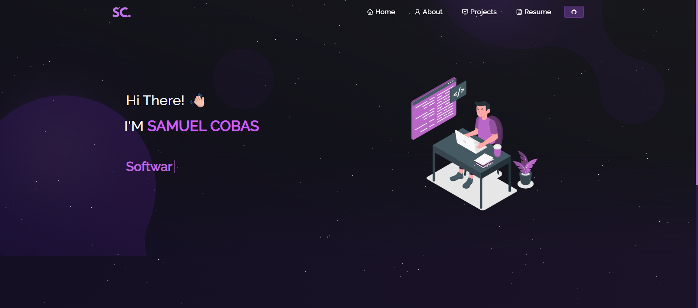

# Samuel Cobas Portfolio

Portfolio application built with TanStack Start, React 19, Tailwind CSS, and shadcn/ui primitives. The active application lives under `app/`.

## Stack

- TanStack Start with a Vite-based build pipeline
- React 19
- TypeScript
- Tailwind CSS
- shadcn/ui and Radix primitives

## Available Scripts

- `pnpm dev` starts the main app on port `3002`.
- `pnpm build` creates the production build.
- `pnpm smoke` builds the app and checks the main routes plus their page metadata across all supported locales.
- `pnpm start` serves the built app with `vite preview`.
- `pnpm typecheck` runs the TypeScript checker.

## Project Structure

- `app/` contains the current TanStack Start application.
- `app/components/` contains the reusable UI used by the migrated routes.
- `app/routes/` contains the file-based route modules.
- `app/lib/` contains app content, assets, and utilities.
- `public/` contains static web assets such as `manifest.json` and `robots.txt`.

## Development Notes

- If you are updating the active portfolio, start in `app/`.
- App-owned assets now live in `app/assets/`.
- The repository uses `pnpm` as the package manager.

## Credit

Original portfolio inspiration: [Soumyajit4419/Portfolio](https://github.com/Soumyajit4419/Portfolio).
